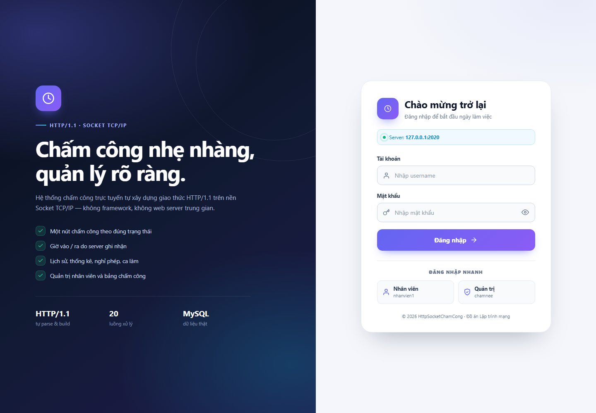
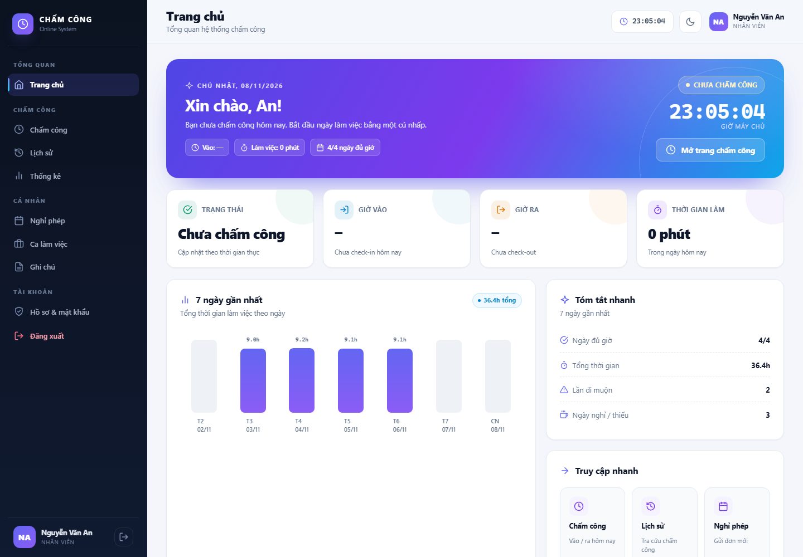
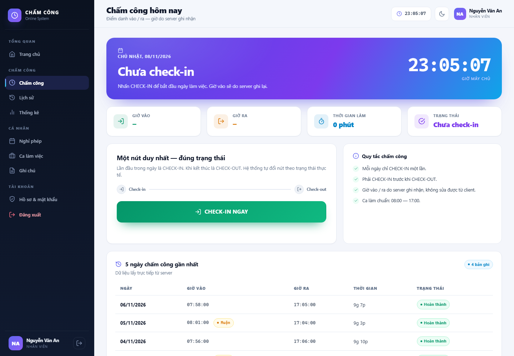
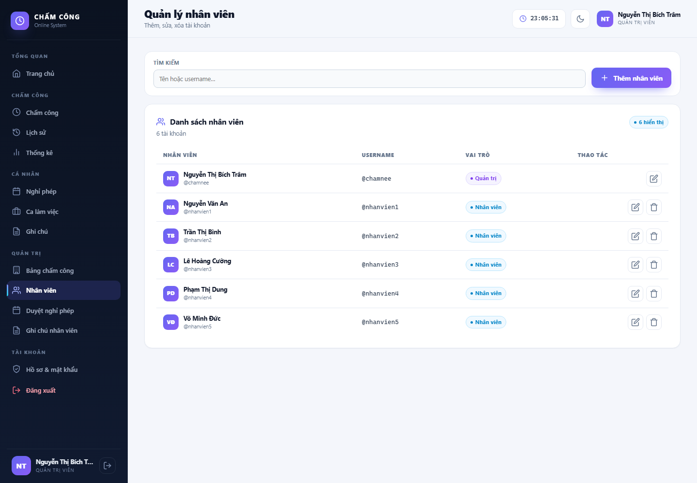
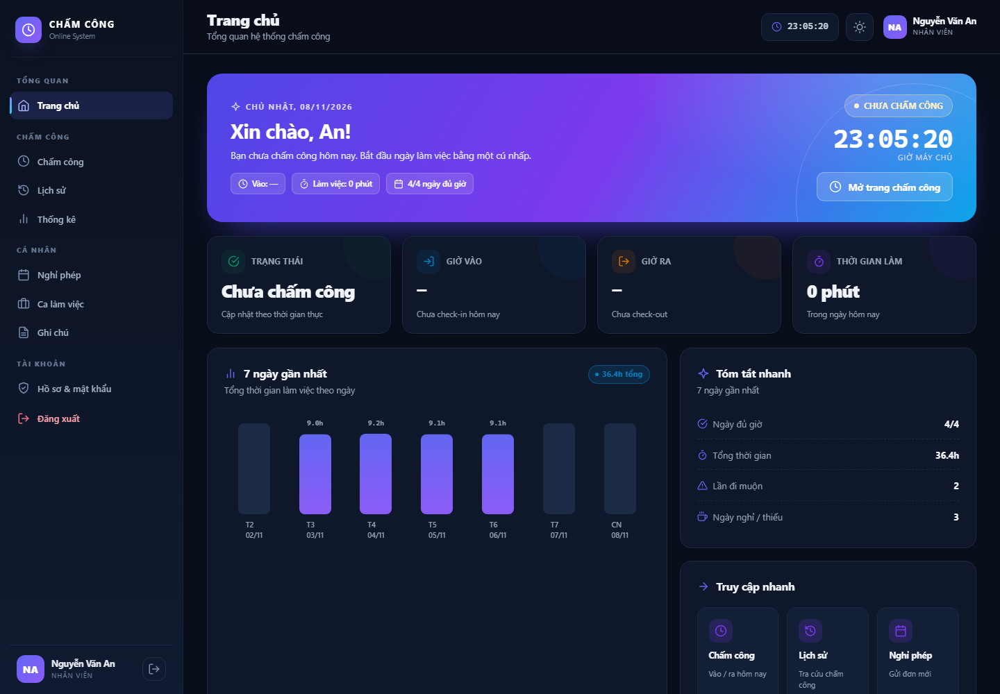

# 🕒 HttpSocketChamCong - Hệ thống Chấm công Trực tuyến

> **Đồ án Lập trình mạng** — Sử dụng giao thức **HTTP/1.1** trên nền **Socket TCP/IP** theo mô hình **Client-Server**, viết bằng ngôn ngữ **Java**.

[](https://www.oracle.com/java/)
[](https://openjfx.io/)
[](https://www.mysql.com/)
[](LICENSE)

---

## 📋 Mục lục

- [Giới thiệu](#-giới-thiệu)
- [Tính năng](#-tính-năng)
- [Kiến trúc hệ thống](#-kiến-trúc-hệ-thống)
- [Công nghệ sử dụng](#-công-nghệ-sử-dụng)
- [Cấu trúc project](#-cấu-trúc-project)
- [Cài đặt](#-cài-đặt)
- [Chạy chương trình](#-chạy-chương-trình)
- [API Endpoints](#-api-endpoints)
- [Kiểm tra HTTP/1.1](#-kiểm-tra-http11)
- [Tài khoản demo](#-tài-khoản-demo)
- [Demo 2 máy LAN](#-demo-2-máy-lan)
- [Screenshots](#-screenshots)
- [Tác giả](#-tác-giả)

---

## 🎯 Giới thiệu

Đây là **đồ án môn Lập trình mạng**, xây dựng **Hệ thống Chấm công trực tuyến** sử dụng:

- ✅ **Giao thức HTTP/1.1** — tự parse request, tự build response (KHÔNG dùng framework)
- ✅ **Socket TCP/IP** — `ServerSocket` + `Socket` thuần Java
- ✅ **Mô hình Client-Server** — Server đa luồng (20 threads)
- ✅ **Web client** — HTML/CSS/JavaScript thuần, chạy trên trình duyệt
- ✅ **JavaFX desktop client** — client desktop tự build HTTP request (legacy/demo)
- ✅ **MySQL** — lưu trữ dữ liệu thật
- ✅ **JDBC** — kết nối database

### ⚠️ Web client nhưng KHÔNG dùng web server/framework

Hệ thống có **2 client** dùng chung một server:

| Client | Công nghệ | Mục đích |
|--------|-----------|----------|
| **Web client (chính)** | HTML/CSS/JS thuần | Mở bằng trình duyệt tại `http://localhost:2020/` |
| **JavaFX desktop (legacy)** | JavaFX 21 | Demo client tự build HTTP request bằng Socket |

Điểm quan trọng: **HTML/CSS/JS do chính server Java tự phục vụ** qua `StaticFileHandler`.
Không có Tomcat / Jetty / Spring Boot / Nginx / Apache ở giữa.

- ❌ Không dùng web framework phía server
- ✅ Server tự parse HTTP/1.1 và tự trả file tĩnh + JSON API
- ✅ Trình duyệt chỉ thay thế phần giao diện — **giao thức vẫn là HTTP/1.1 trên Socket TCP/IP**
- ✅ JavaFX client vẫn được giữ để chứng minh phần tự build HTTP request thủ công

---

## ✨ Tính năng

### 👤 Nhân viên (USER)

- 🔐 Đăng nhập với token (Bearer authentication)
- ✅ **Chấm công hợp nhất** — một trang duy nhất, nút hành động đổi theo trạng thái:
  `Chưa chấm công → CHECK-IN → Đang làm việc → CHECK-OUT → Hoàn thành`
- 🕐 Thời gian chấm công do **server** ghi nhận (client không thể sửa)
- 📋 Xem **lịch sử chấm công** cá nhân, lọc theo khoảng ngày, xuất CSV
- 📊 Xem **thống kê** (tổng ngày, tỷ lệ hoàn thành, đi muộn, giờ trung bình)
- 🌴 Gửi / hủy **đơn nghỉ phép**
- 🗓️ Đăng ký / xóa **ca làm việc**
- 📝 Lưu **ghi chú công việc** theo ngày
- 🔑 Đổi mật khẩu

### 👑 Quản trị viên (ADMIN)

- 🎁 Tất cả quyền của nhân viên
- 👥 Xem **bảng chấm công toàn công ty**, lọc theo nhân viên / ngày, xuất CSV
- 🧑‍💼 **Quản lý nhân viên**: thêm, sửa vai trò, xóa tài khoản
- ✅ **Duyệt / từ chối** đơn nghỉ phép
- 📝 Xem ghi chú công việc của toàn bộ nhân viên

### 🖥️ Giao diện

- 🌗 Web SPA responsive, có **dark mode**
- 🎨 Thiết kế hiện đại: sidebar, hero, card, bảng dữ liệu, modal xác nhận, toast
- 📱 Hoạt động tốt trên desktop, tablet và điện thoại
- 🖥️ Server Dashboard JavaFX (START/STOP, log realtime, clients) vẫn giữ nguyên

---

## 🏗️ Kiến trúc hệ thống

```
┌──────────────────────────┐          ┌──────────────────────────┐
│  WEB CLIENT              │          │  JAVAFX CLIENT (legacy)  │
│  HTML/CSS/JS thuần       │          │  Tự build HTTP request   │
│  fetch() → HTTP/1.1      │          │  Socket + String thủ công│
└────────────┬─────────────┘          └────────────┬─────────────┘
             │                                     │
             └──────────────┬──────────────────────┘
                            │  HTTP/1.1 over TCP/IP — Port 2020
                            ▼
             ┌────────────────────────────────────┐
             │  JAVA SERVER (raw Socket)          │
             │  ServerSocket + 20 threads         │
             │  HttpRequestParser / ResponseBuilder│
             │  Router → JSON API + Static files  │
             └──────────────┬─────────────────────┘
                            │ JDBC
                            ▼
             ┌────────────────────────────────────┐
             │  MySQL Database — chamcong_db      │
             │    - users                         │
             │    - chamcong                      │
             │    - leave_requests                │
             │    - work_shifts / work_notes      │
             └────────────────────────────────────┘
```

### Luồng hoạt động

1. **Client** (trình duyệt hoặc JavaFX) mở kết nối TCP tới server port `2020`
2. Client gửi **HTTP/1.1 request**:
   - Web: trình duyệt tự build request từ `fetch()`
   - JavaFX: tự build request thủ công bằng `SocketHttpClient`
3. **Server** `ServerSocket.accept()` → tạo thread mới (ExecutorService 20 luồng)
4. Server **tự parse HTTP request**: Request Line → Headers → Body
5. Server xử lý → **tự build HTTP response** → ghi ra socket
6. Với path không phải `/api/`, server đọc file trong `web/` và trả về HTML/CSS/JS
7. Client nhận response → hiển thị kết quả

---

## 🛠️ Công nghệ sử dụng

| Công nghệ | Phiên bản | Mục đích |
|-----------|-----------|----------|
| **Java** | 17+ | Ngôn ngữ chính |
| **HTML / CSS / JavaScript** | Thuần (vanilla) | Web client — không framework |
| **JavaFX** | 21.0.5 | Desktop client (legacy/demo) |
| **Ikonli** | 12.3.1 | Icon Font Awesome (JavaFX) |
| **MySQL** | 8.0+ | Database |
| **MySQL Connector/J** | 8.4.0+ | JDBC driver |
| **XAMPP** | 8.2+ | Chạy MySQL local |

---

## 📁 Cấu trúc project

```
HttpSocketChamCong/
│
├── web/                            ← Web client (HTML/CSS/JS thuần)
│   ├── index.html                  ← SPA shell + login + icon sprite
│   ├── favicon.svg
│   └── assets/
│       ├── app.css                 ← Giao diện responsive + dark mode
│       └── app.js                  ← Router SPA + gọi API bằng fetch()
│
├── .vscode/
│   ├── settings.json              ← Cấu hình Java cho VS Code
│   └── launch.json                ← Cấu hình Run Server/Client
│
├── database/
│   └── chamcong_db.sql            ← Script tạo database + dữ liệu mẫu
│
├── lib/
│   ├── mysql-connector-j-*.jar    ← JDBC driver
│   ├── ikonli-*.jar                ← Icon FontAwesome
│   └── javafx-sdk-21.0.5/         ← JavaFX SDK
│
├── src/
│   └── com/httpchamcong/
│       │
│       ├── model/                  ← Model classes
│       │   ├── User.java
│       │   ├── ChamCong.java
│       │   ├── LeaveRequest.java
│       │   ├── WorkShift.java
│       │   └── WorkNote.java
│       │
│       ├── dao/                    ← Data Access Object
│       │   ├── DBConnection.java
│       │   ├── UserDAO.java
│       │   ├── ChamCongDAO.java
│       │   ├── LeaveDAO.java
│       │   ├── WorkShiftDAO.java
│       │   └── WorkNoteDAO.java
│       │
│       ├── util/                   ← Tiện ích
│       │   ├── JsonUtil.java
│       │   └── SessionManager.java
│       │
│       ├── server/                 ← HTTP Server (Socket TCP)
│       │   ├── HttpSocketServer.java       ← ServerSocket chính
│       │   ├── ClientHandler.java          ← Mỗi client = 1 thread
│       │   ├── HttpRequestParser.java      ← Tự parse HTTP request
│       │   ├── HttpResponseBuilder.java    ← Tự build HTTP response
│       │   ├── Router.java                 ← Điều hướng URL
│       │   ├── StaticFileHandler.java      ← Phục vụ web/ (HTML/CSS/JS)
│       │   ├── ServerStats.java            ← Thống kê
│       │   ├── ClientManager.java          ← Quản lý clients
│       │   ├── ServerApp.java              ← Giao diện Server Dashboard
│       │   │
│       │   └── controller/
│       │       ├── AuthController.java
│       │       ├── ChamCongController.java
│       │       ├── AdminController.java
│       │       ├── UserController.java
│       │       ├── LeaveController.java
│       │       ├── WorkShiftController.java
│       │       └── NoteController.java
│       │
│       └── client/                 ← HTTP Client (legacy)
│           ├── SocketHttpClient.java       ← Tự build HTTP request
│           └── ClientApp.java              ← Giao diện JavaFX
│
├── docs/                           ← Tài liệu + ảnh chụp web client
│   ├── HTTP_AUDIT.md
│   └── screenshots/
│
├── README.md                       ← File này
├── .gitignore                      ← Bỏ file rác khi push Git
└── LICENSE                         ← MIT License
```

---

## ⚙️ Cài đặt

### Bước 1: Cài đặt môi trường

#### 1.1. JDK 17+

```bash
# Kiểm tra
java -version
javac -version
```

Nếu chưa có → tải **JDK 17**: https://adoptium.net/

#### 1.2. XAMPP (MySQL)

Tải: https://www.apachefriends.org/

- Cài đặt XAMPP
- Mở XAMPP Control Panel → **Start MySQL** (port 3307)
- **KHÔNG cần Start Apache/Tomcat**

#### 1.3. VS Code + Extensions

- **Extension Pack for Java** (Microsoft)

### Bước 2: Clone project

```bash
git clone https://github.com/<username>/HttpSocketChamCong.git
cd HttpSocketChamCong
```

### Bước 3: Tải thư viện (lib/)

Tải và copy vào `lib/`:

| Thư viện | Link | File cần |
|----------|------|----------|
| **MySQL Connector/J** | https://dev.mysql.com/downloads/connector/j/ | `mysql-connector-j-*.jar` |
| **JavaFX SDK 21.0.5** | https://gluonhq.com/products/javafx/ | Thư mục `javafx-sdk-21.0.5/` |
| **Ikonli** | https://repo1.maven.org/maven2/org/kordamp/ikonli/ | 4 file `ikonli-*.jar` |

**Chi tiết Ikonli** — tải 4 file:
- `ikonli-core-12.3.1.jar`
- `ikonli-javafx-12.3.1.jar`
- `ikonli-fontawesome5-pack-12.3.1.jar`
- `ikonli-fontawesome-pack-12.3.1.jar`

### Bước 4: Tạo Database

Mở **phpMyAdmin** (http://localhost/phpmyadmin) hoặc **MySQL Workbench**:

1. Chạy script `database/chamcong_db.sql`
2. Sẽ tạo database `chamcong_db` với 5 bảng:
   - `users` — tài khoản (6 users)
   - `chamcong` — lịch sử chấm công
   - `leave_requests` — đơn nghỉ phép
   - `work_shifts` — ca làm việc
   - `work_notes` — ghi chú công việc

### Bước 5: Cấu hình kết nối

Mặc định server tự thử **port 3307 trước, sau đó 3306** (XAMPP có thể cấu hình 1 trong 2 port):

```java
// src/com/httpchamcong/dao/DBConnection.java
"jdbc:mysql://localhost:3307/chamcong_db"   // thử trước
"jdbc:mysql://localhost:3306/chamcong_db"   // fallback
```

Có thể override mà **không cần sửa code** bằng system property hoặc biến môi trường:

| System property | Biến môi trường | Mặc định |
|-----------------|-----------------|----------|
| `-Dchamcong.db.url=` | `CHAMCONG_DB_URL` | tự thử 3307 → 3306 |
| `-Dchamcong.db.user=` | `CHAMCONG_DB_USER` | `root` |
| `-Dchamcong.db.password=` | `CHAMCONG_DB_PASSWORD` | rỗng |

Ví dụ khi root có mật khẩu:

```bash
java -Dchamcong.db.password=matkhau -cp "bin;lib/mysql-connector-j-26.7.0.jar" ^
    com.httpchamcong.server.HttpSocketServer
```

---

## 🚀 Chạy chương trình

### Bước 1: Compile

```bat
:: Tạo danh sách toàn bộ source (bao gồm mọi controller/DAO/model)
dir /s /b src\*.java > sources.txt

javac -encoding UTF-8 -d bin ^
    --module-path "lib\javafx-sdk-21.0.5\lib" ^
    --add-modules javafx.controls,javafx.fxml ^
    -cp "lib\mysql-connector-j-26.7.0.jar;lib\ikonli-core-12.3.1.jar;lib\ikonli-javafx-12.3.1.jar;lib\ikonli-fontawesome5-pack-12.3.1.jar;lib\ikonli-fontawesome-pack-12.3.1.jar" ^
    @sources.txt
```

### Bước 2: Chạy Server

**Terminal 1:**

```bash
java --module-path "lib/javafx-sdk-21.0.5/lib" --add-modules javafx.controls,javafx.fxml ^
    -cp "bin;lib/mysql-connector-j-26.7.0.jar;lib/ikonli-core-12.3.1.jar;lib/ikonli-javafx-12.3.1.jar;lib/ikonli-fontawesome5-pack-12.3.1.jar;lib/ikonli-fontawesome-pack-12.3.1.jar" ^
    com.httpchamcong.server.ServerApp
```

→ Click **START SERVER** → Status 🟢 RUNNING

> 💡 Có thể chạy server **headless** (không cần JavaFX) — cách nhanh nhất để dùng Web client:
>
> ```bash
> java -cp "bin;lib/mysql-connector-j-26.7.0.jar" com.httpchamcong.server.HttpSocketServer
> ```
>
> Khi khởi động, log sẽ in:
> `[WEB] http://localhost:2020/  (web root: .../web)`
>
> Mặc định lắng nghe `0.0.0.0:2020`.

### Bước 3: Mở Web client

Mở trình duyệt và truy cập:

```
http://localhost:2020/
```

→ Đăng nhập bằng tài khoản demo → sử dụng toàn bộ chức năng.

> 🌐 Web client được phục vụ bởi chính server Java (`web/index.html`, `web/assets/app.css`, `web/assets/app.js`).
>
> Nếu chạy server từ thư mục khác, chỉ định thư mục web:
> ```bash
> java -Dchamcong.web.dir="F:\HttpSocketChamCong\web" -cp "bin;lib/mysql-connector-j-26.7.0.jar" com.httpchamcong.server.HttpSocketServer
> ```
> hoặc đặt biến môi trường `CHAMCONG_WEB_DIR`.

### Bước 4: Chạy JavaFX client (tùy chọn — legacy)

**Terminal 2 (mở mới):**

```bash
java --module-path "lib/javafx-sdk-21.0.5/lib" --add-modules javafx.controls,javafx.fxml ^
    -cp "bin;lib/mysql-connector-j-26.7.0.jar;lib/ikonli-core-12.3.1.jar;lib/ikonli-javafx-12.3.1.jar;lib/ikonli-fontawesome5-pack-12.3.1.jar;lib/ikonli-fontawesome-pack-12.3.1.jar" ^
    com.httpchamcong.client.ClientApp
```

→ Login → Chấm công

> Client JavaFX giữ lại để demo phần **tự build HTTP request bằng Socket**.
> Web client là giao diện chính, không cần JavaFX.

---

## 🌐 API Endpoints

| Method | Path | Mô tả | Auth |
|--------|------|-------|------|
| `GET` | `/` | Web client (`web/index.html`) | ❌ |
| `GET` | `/assets/*` | CSS / JS / favicon | ❌ |
| `POST` | `/api/login` | Đăng nhập, trả token | ❌ |
| `POST` | `/api/logout` | Đăng xuất | ✅ |
| `GET` | `/api/ping` | Kiểm tra server | ❌ |
| `GET` | `/api/attendance/today` | Trạng thái chấm công hôm nay (alias `/api/today`) | ✅ |
| `POST` | `/api/checkin` | Chấm công vào | ✅ |
| `POST` | `/api/checkout` | Chấm công ra | ✅ |
| `GET` | `/api/history` | Lịch sử chấm công (phân trang, lọc ngày/user) | ✅ |
| `GET` | `/api/export/csv` | Xuất CSV | ✅ |
| `GET` | `/api/profile` | Thông tin tài khoản | ✅ |
| `POST` | `/api/change-password` | Đổi mật khẩu | ✅ |
| `POST` | `/api/register` | Đăng ký tài khoản | ❌ |
| `GET` | `/api/leaves` | Danh sách đơn nghỉ (admin) | ✅ ADMIN |
| `POST` | `/api/leaves` | Gửi đơn nghỉ phép | ✅ |
| `GET` | `/api/leave-list` | Đơn nghỉ của chính mình | ✅ |
| `DELETE` | `/api/leaves/{id}` | Hủy đơn đang chờ duyệt | ✅ |
| `POST` | `/api/admin/leave/update` | Duyệt / từ chối đơn | ✅ ADMIN |
| `GET` | `/api/work-shifts/list` | Danh sách ca làm | ✅ |
| `POST` | `/api/work-shifts/register` | Đăng ký ca | ✅ |
| `DELETE` | `/api/work-shifts/{id}` | Xóa ca | ✅ |
| `POST` | `/api/notes/save` | Lưu ghi chú | ✅ |
| `GET` | `/api/notes/my` | Ghi chú của mình | ✅ |
| `GET` | `/api/notes/today` | Ghi chú hôm nay | ✅ |
| `GET` | `/api/notes/all` | Ghi chú toàn công ty | ✅ ADMIN |
| `DELETE` | `/api/notes/{id}` | Xóa ghi chú | ✅ |
| `GET` | `/api/admin/all` | Admin xem tất cả chấm công | ✅ ADMIN |
| `GET` / `POST` | `/api/admin/users` | Danh sách / thêm nhân viên | ✅ ADMIN |
| `PATCH` / `DELETE` | `/api/admin/users/{username}` | Sửa / xóa nhân viên | ✅ ADMIN |
| `GET` | `/api/admin/leaves` | Đơn nghỉ toàn công ty | ✅ ADMIN |
| `OPTIONS` | `*` | Trả danh sách method (`204` + `Allow`) | ❌ |

`GET /api/attendance/today` trả về trạng thái để UI quyết định nút hành động:

```json
{
  "date": "2026-11-07",
  "checkIn": "08:01:23",
  "checkOut": "",
  "status": "WORKING",
  "workedMinutes": 123,
  "serverTime": "10:04:23"
}
```

`status` ∈ `NOT_CHECKED_IN` | `WORKING` | `COMPLETED`.

### Ví dụ HTTP Request thủ công

```http
POST /api/login HTTP/1.1
Host: localhost:2020
User-Agent: JavaChamCongClient/1.0
Accept: application/json
Content-Type: application/json; charset=UTF-8
Content-Length: 48
Connection: close

{"username":"chamnee","password":"Chamnee@2025"}
```

### Ví dụ HTTP Response

```http
HTTP/1.1 200 OK
Server: JavaChamCongServer/1.1
Date: Sat, 07 Nov 2026 16:05:01 GMT
Connection: close
Content-Type: application/json; charset=UTF-8
Content-Length: 145

{"token":"a1b2c3d4-...","user":{"username":"chamnee","fullName":"Nguyễn Thị Bích Trâm","role":"ADMIN"}}
```

---

## ✅ Kiểm tra HTTP/1.1

Server được kiểm thử bằng **raw TCP socket** (không dùng thư viện HTTP) với bộ **22 test case**,
bao gồm: request line, `Host` bắt buộc, `505` cho version sai, `HEAD`/`OPTIONS`, `Date` RFC 1123,
`204` không body, `405` + `Allow`, body UTF-8 theo `Content-Length`, và toàn bộ luồng chấm công.

```
RESULT: 22 / 22 passed
```

Chi tiết ma trận tuân thủ, lỗi đã sửa và hạn chế còn lại: **[docs/HTTP_AUDIT.md](docs/HTTP_AUDIT.md)**.

Các giới hạn còn lại: chưa hỗ trợ chunked request,
không TLS, mật khẩu chưa băm, session trong bộ nhớ chưa hết hạn, chưa rate-limit. Persistent connection (HTTP/1.1 keep-alive) đã được hỗ trợ.

---

## 🔑 Tài khoản demo

| Username | Password | Vai trò | Họ tên |
|----------|----------|---------|--------|
| **chamnee** | `Chamnee@2025` | **ADMIN** | Nguyễn Thị Bích Trâm |
| nhanvien1 | `Nhanvien1@` | USER | Nguyễn Văn An |
| nhanvien2 | `Nhanvien2@` | USER | Trần Thị Bình |
| nhanvien3 | `Nhanvien3@` | USER | Lê Hoàng Cường |
| nhanvien4 | `Nhanvien4@` | USER | Phạm Thị Dung |
| nhanvien5 | `Nhanvien5@` | USER | Võ Minh Đức |

---

## 🌐 Demo 2 máy LAN

### Điều kiện

- 2 máy **cùng mạng Wi-Fi (LAN)**
- Máy Server **START SERVER** trước
- Firewall máy Server **mở port 2020**

### Cách làm

#### Máy Server (máy Trâm):

1. Chạy server (ServerApp → **START SERVER**, hoặc chạy headless)
2. Lấy IP LAN của máy server, ví dụ `192.168.1.100` (ServerApp hiển thị trên header)
3. Mở firewall port 2020 (hoặc tắt firewall tạm thời)

#### Máy Client (máy Tri) — Web client (khuyến nghị):

1. **Không cần copy project** — chỉ cần trình duyệt
2. Mở: `http://192.168.1.100:2020/`
3. Đăng nhập → chấm công ngay

#### Máy Client (máy Tri) — JavaFX client (tùy chọn):

1. **Copy project** sang máy Tri (USB / Google Drive)
2. Không cần sửa code — chạy client với địa chỉ server qua system property:
   ```bash
   java -Dchamcong.server.host=192.168.1.100 ^
       --module-path "lib/javafx-sdk-21.0.5/lib" --add-modules javafx.controls,javafx.fxml ^
       -cp "bin;lib/mysql-connector-j-26.7.0.jar;lib/ikonli-core-12.3.1.jar;lib/ikonli-javafx-12.3.1.jar;lib/ikonli-fontawesome5-pack-12.3.1.jar;lib/ikonli-fontawesome-pack-12.3.1.jar" ^
       com.httpchamcong.client.ClientApp
   ```
   Hoặc đặt biến môi trường `CHAMCONG_SERVER_HOST=192.168.1.100`.
   Có thể đổi port bằng `-Dchamcong.server.port=2020`.
3. Chạy Client → Login → chấm công
4. **Server Dashboard** (máy Trâm) → tab **Clients** → thấy Tri với IP `192.168.1.105`

> Mặc định client JavaFX kết nối `localhost:2020`, phù hợp chạy 1 máy.
> Web client dùng chính host đang mở trên trình duyệt, không cần cấu hình.

---

## 📸 Screenshots

### Web — Đăng nhập



### Web — Trang chủ (light)



### Web — Chấm công



### Web — Quản lý nhân viên



### Web — Dark mode



> JavaFX client legacy vẫn chạy được nhưng không còn là giao diện chính. Ảnh chụp JavaFX cũ không được đưa vào tài liệu này.

---

## 🎓 Điểm nổi bật

Đồ án thể hiện các kiến thức **Lập trình mạng**:

- ✅ **Socket TCP/IP** — `ServerSocket`, `Socket`
- ✅ **Giao thức HTTP/1.1** — tự parse request, tự build response
- ✅ **Đa luồng** — `ExecutorService` (20 threads)
- ✅ **RESTful API** — routing theo URL
- ✅ **Static file serving** — tự phục vụ HTML/CSS/JS, không web server ngoài
- ✅ **Web client thuần** — SPA, responsive, dark mode, không framework
- ✅ **Authentication** — token Bearer
- ✅ **Database thật** — MySQL + JDBC
- ✅ **JavaFX client (legacy)** — tự build HTTP request thủ công
- ✅ **Mô hình Client-Server** đầy đủ

---

## 📝 License

MIT License — xem file [LICENSE](LICENSE).

---

## 👤 Tác giả

**Nguyễn Thị Bích Trâm**

- 🎓 Sinh viên ngành Công nghệ Thông tin
- 📚 Môn: Lập trình mạng
- 📅 Năm học: 2025-2026

---

## 🙏 Cảm ơn

- Thầy hướng dẫn môn Lập trình mạng
- Cộng đồng Java Việt Nam

---

## 📞 Liên hệ

Nếu có thắc mắc → tạo [Issue](https://github.com/<username>/HttpSocketChamCong/issues) hoặc liên hệ trực tiếp.
